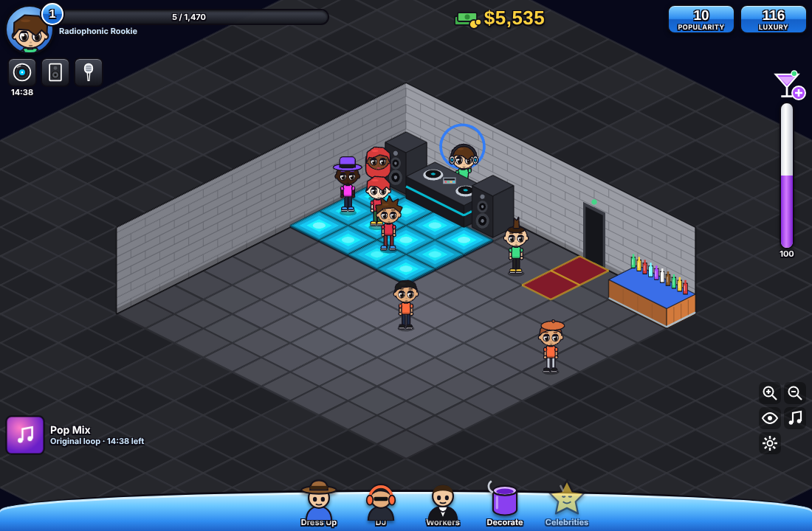
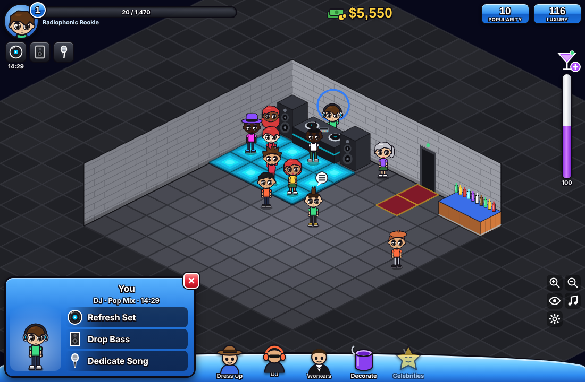
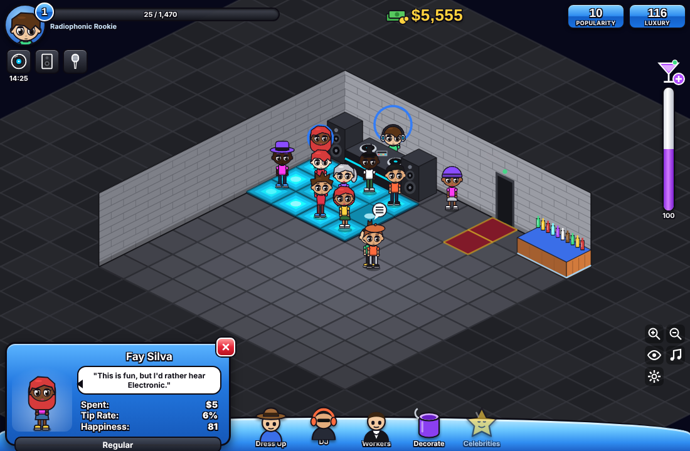
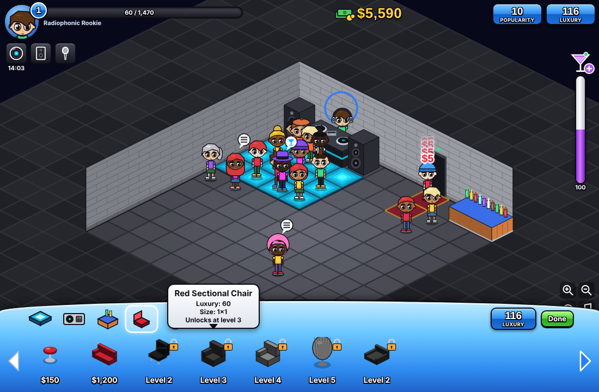
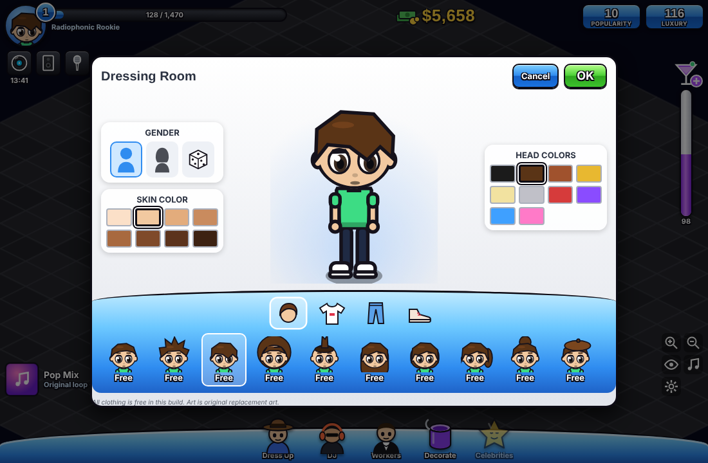
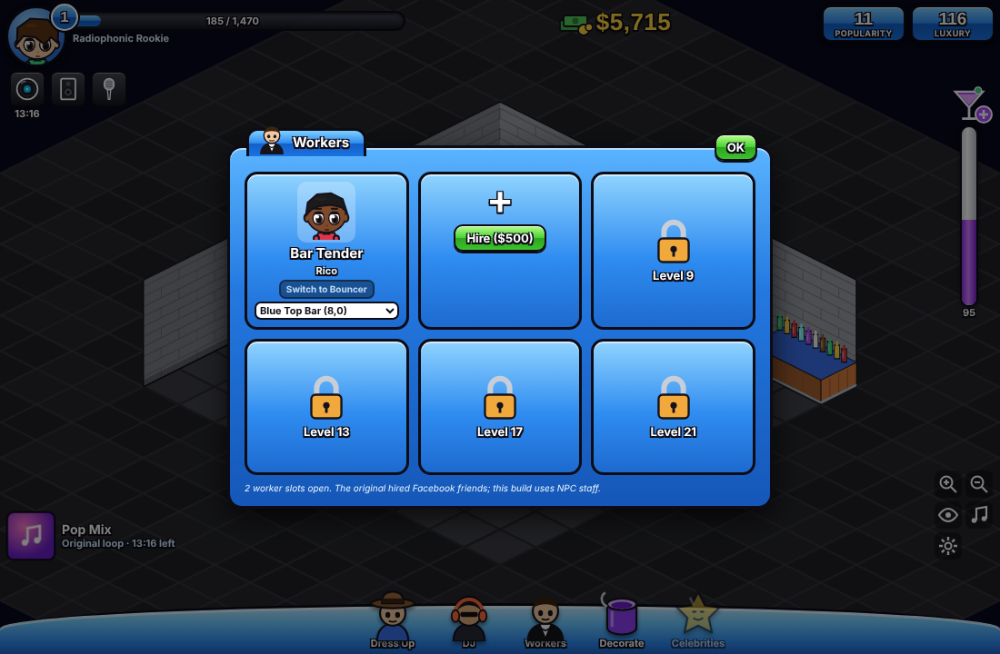

# NightClub Revive

An unofficial fan reconstruction of the 2010 Facebook/browser game **Nightclub City** (Booyah). It is rebuilt as a standalone browser game that runs locally, using public walkthroughs, reviews and screenshots as evidence.

The layout, characters, furniture and interface are modelled closely on historical screenshots. Everything is **drawn fresh in code**, and the music is **original, generated live**. The game contains **no original code, art or music**. See [`docs/EVIDENCE_REGISTER.md`](docs/EVIDENCE_REGISTER.md) for what is historical and what is proposed.



| DJ card | Guest card | Decorate |
|---|---|---|
|  |  |  |
| **Dressing room** | **Workers** | |
|  |  | |

## How to run it

**You need:** [Node.js](https://nodejs.org/) 18 or newer (20+ recommended) and a modern desktop browser (Chrome, Edge, Firefox or Safari).

1. Get the code, either way works:
   - **No git:** on GitHub click **Code → Download ZIP**, unzip it, and open a terminal inside the unzipped folder (e.g. `cd NightClub-Revive-main`).
   - **With git:**
     ```bash
     git clone https://github.com/riesources/NightClub-Revive.git
     cd NightClub-Revive
     ```
2. Install dependencies (first time only):
   ```bash
   npm install
   ```
3. Start the game:
   ```bash
   npm run dev
   ```
4. Open **http://localhost:5173** in your browser.

To stop the game, press `Ctrl+C` in the terminal.

### Build a standalone copy

```bash
npm run build      # writes the game to dist/
npm run preview    # serves dist/ at http://localhost:4173
```

The `dist/` folder is plain static files. You can host it on any static web host, for example GitHub Pages or Netlify.

### How to play

- **Start the music:** click the record button (top left) or the **DJ** icon on the dock, then **Refresh Set** and pick a mix. Click once anywhere first if your browser blocks sound.
- **Guests** pay a cover charge at the door, dance and buy drinks. Keep the **drink tube** (right) stocked: click **+** to restock.
- **Drop Bass** sends everyone to the bar. **Dedicate Song** lets you click a guest to cheer them up.
- **Decorate** (paint bucket): pick an item, then click a tile to buy it. `R` rotates, and `Esc` or right-click cancels. Click placed furniture to move or sell it.
- Drag to pan, and scroll to zoom. Click any guest to see their card.

Your club saves automatically in your browser. Use **Settings** (gear icon) to export, import or reset your save.

### For developers

```bash
npm test           # unit tests (Vitest)
npm run typecheck  # TypeScript check
npm run smoke      # headless browser smoke test (run npm run build first)
```

## Built with

The game is written in **TypeScript** and runs in any modern web browser.

- **Game engine: Phaser 3.** This draws the isometric club, moves the guests around and handles mouse input.
- **Interface: HTML and CSS.** The panels, cards, buttons and HUD are ordinary web page elements laid over the game. The icons are SVG drawings written directly in the code.
- **Graphics: drawn in code.** There are no image files. Characters and furniture are made of shapes in TypeScript, using Phaser for the club and the browser's built-in drawing canvas for the menu pictures.
- **Music: the Web Audio API.** The browser's built-in sound system generates the drums, bass and chords live.
- **Tools:**
  - Vite runs the development server and builds the finished game.
  - Vitest runs the unit tests.
  - Playwright runs the automated tests in a real browser.
  - Node.js and npm install and run all of these.

## What works

- The original-style HUD: portrait, level and XP, DJ quick buttons with timer, gold cash, POPULARITY/LUXURY badges, drink tube, now playing, and the character dock.
- Chibi guests who pay a $5 cover, dance, queue at bars, buy drinks and tip, with a guest card showing Spent / Tip Rate / Happiness.
- DJ card with **Refresh Set / Drop Bass / Dedicate Song**. Club Mix, Hip-Hop, Electronic and Pop mixes, each with its own procedural music.
- Build band with furniture thumbnails, prices and luxury tooltips. Buy, move, rotate and sell.
- Workers panel with slots that unlock at levels 9/13/17/21. Level-up screen. Dressing room with gender, dice, skin and head colours.
- Autosave with versioned migrations and corrupt-save recovery. Debug overlay.

Not built yet: bouncers, parties, celebrities, neighbors/friends bar. See [`docs/BUILD_LOG.md`](docs/BUILD_LOG.md).

## Layout

```
src/data/         catalogue, tuning (every uncertain value, labelled), progression, appearance options
src/domain/       pure game rules: economy, grid, bar, DJ, staff, progression, guest simulation, A*
src/persistence/  save repository, validation, migrations
src/render/       iso projection and procedural art
src/scenes/       Phaser club scene (reads domain state, never mutates it directly)
src/ui/           DOM HUD, panels, modals
tests/unit/       Vitest
scripts/smoke.mjs headless browser smoke test
docs/             audit, evidence, decisions, assets, test plan, build log, spec/ (original brief)
```

## Legal

This is a non-commercial preservation and fan project with no affiliation to Booyah or any rights holder. "Nightclub City" is used only to describe what is being reconstructed.
